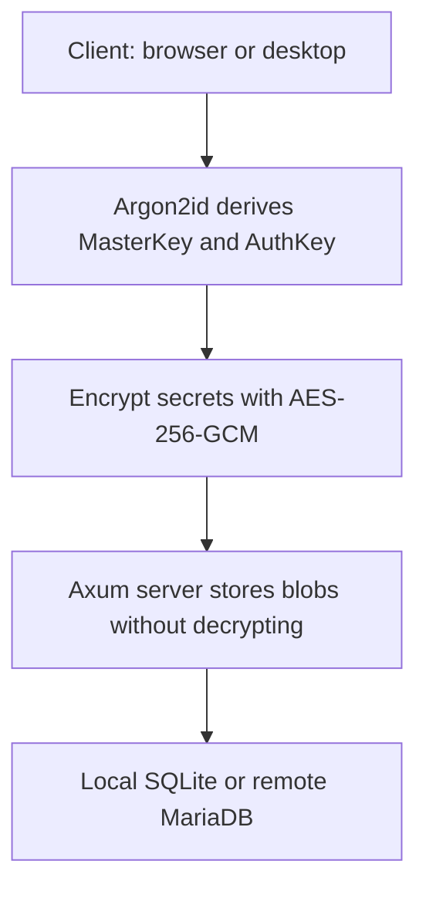

## The Challenge
A self-hosted password manager is worth little if the server can read the secrets: a single breach loses everything. The goal of **Pact** was a vault where the server syncs without being able to decrypt, wrapped in a fast desktop app with an interface that does not look like a sysadmin tool.

## Technical Solution
Everything sensitive is encrypted on the client before leaving the device. The `MasterKey` is derived with **Argon2id** and never travels; the server only keeps an `AuthKey` verifier and **AES-256-GCM** blobs it cannot read: titles, urls, usernames, passwords, folder names, icons and TOTP seeds.

### Key implementation points
- **Cryptographic core in Rust:** `pact-core` derives keys and encrypts; the web client runs the same code compiled to **WASM**, because WebCrypto does not implement Argon2id.
- **Local TOTP:** Seeds travel encrypted and codes are generated on the client, with a 30-second countdown on each account card.
- **Two vaults:** A local `.pact` file (SQLite) or remote sync on **MariaDB**, switchable from settings.
- **Blind server:** **Axum** + SQLx; the server persists data and serves icons through an allowlist, but never sees a secret in the clear.
- **Interface:** **Tauri v2** + **Svelte 5** with Material Design 3, a tonal palette derived from the user's color, and Spanish/English i18n.

### End-to-end flow

### Known limits
Pact encrypts secrets, not metadata: the server still observes structure (account counts, favorites, timestamps) and file-level encryption of the `.pact` container is pending. That is documented in the README instead of hidden.

### Outcome
One vault opens identically on desktop and web, and the server never holds anything it could read it with.

## Takeaway
Pact taught me that end-to-end encryption is not a feature but a discipline about what each party sees: every new field forces the question of whether the server needs to see it. And that honesty about limits (visible metadata, unencrypted container) is part of security design, not an appendix.
