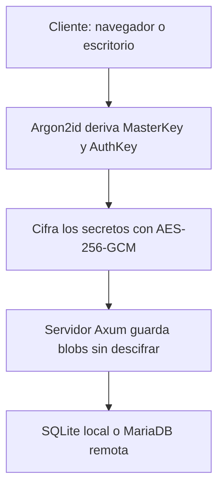

## El Desafío
Un gestor de contraseñas autoalojado no sirve de mucho si el servidor puede leer los secretos: basta una intrusión para perderlo todo. El objetivo de **Pact** fue construir una bóveda donde el servidor sincronice sin poder descifrar, con una aplicación de escritorio rápida y una interfaz que no parezca una herramienta de sistemas.

## Solución Técnica
Todo lo sensible se cifra en el cliente antes de salir del dispositivo. La `MasterKey` se deriva con **Argon2id** y nunca viaja; el servidor solo guarda un verificador de la `AuthKey` y blobs cifrados con **AES-256-GCM** que no puede leer: títulos, urls, usuarios, contraseñas, nombres de carpeta, iconos y semillas TOTP.

### Puntos clave de la implementación
- **Núcleo criptográfico en Rust:** `pact-core` deriva las claves y cifra; el cliente web usa el mismo código compilado a **WASM**, porque WebCrypto no implementa Argon2id.
- **TOTP local:** Las semillas viajan cifradas y los códigos se generan en el cliente, con cuenta atrás de 30 segundos en la tarjeta de cada cuenta.
- **Dos bóvedas:** Archivo `.pact` local (SQLite) o sincronización remota en **MariaDB**, conmutables desde los ajustes.
- **Servidor ciego:** **Axum** + SQLx; el servidor persiste y sirve iconos con allowlist, pero jamás ve un secreto en claro.
- **Interfaz:** **Tauri v2** + **Svelte 5** con Material Design 3, paleta tonal derivada del color del usuario y bilingüe español/inglés.

### Flujo de extremo a extremo

### Límites conocidos
Pact cifra los secretos, no los metadatos: el servidor aún observa la estructura (número de cuentas, favoritos, marcas de tiempo) y el cifrado del contenedor `.pact` a nivel de archivo está pendiente. Está documentado en el README en vez de escondido.

### Resultado
Una sola bóveda se abre igual en escritorio y en web, y el servidor nunca tiene con qué leerla.

## Aprendizaje
Pact me enseñó que el cifrado de extremo a extremo no es una función, sino una disciplina de qué ve cada pieza: cada campo nuevo obliga a preguntar si el servidor necesita verlo. Y que la honestidad sobre los límites (metadatos visibles, contenedor sin cifrar) forma parte del diseño de seguridad, no es un apéndice.
