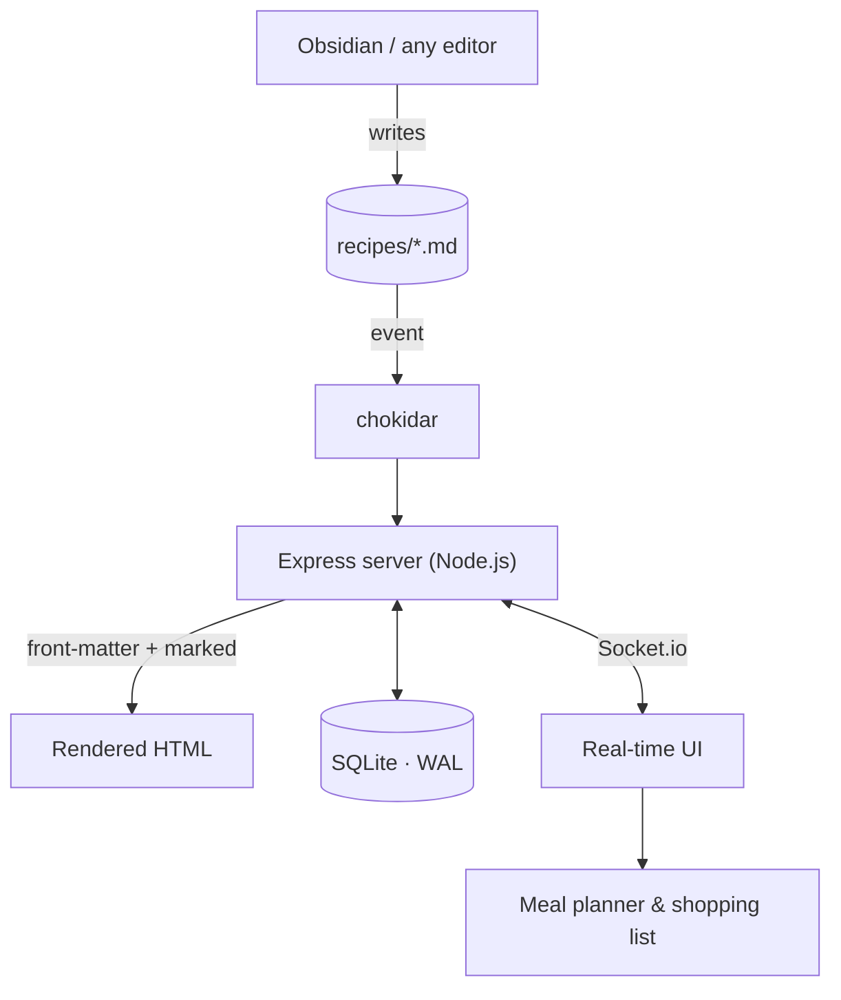

## The Challenge
Most recipe managers rely on proprietary clouds or opaque databases that make portability difficult. I wanted a tool where recipes were simple **Markdown** files (using the File System as the main database), allowing data to be human-readable, editable from anywhere (even from Obsidian), and entirely sovereign.

## Technical Solution
The core of the project is a **Node.js** and **Express** server optimized for file system operations and real-time synchronization.

### Data Architecture
The journey of a recipe, from being edited in any file to showing up on every connected device:

### Implementation Highlights:
- **Markdown as Database:** Recipes are `.md` files. A file-watching system (`chokidar`) monitors the directory and automatically updates the app upon detecting changes, rendering content with `front-matter` and `marked`.
- **Obsidian Compatibility:** Native support for image syntax `![[image.jpg]]` and wikilinks `[[Recipe]]`, seamlessly integrating with Personal Knowledge Management (PKM) workflows.
- **SQLite for Metadata & Cache:** To ensure instant searches and advanced filtering (by tags, ingredients, or difficulty), metadata and secure sessions are managed in **SQLite operating in WAL (Write-Ahead Logging) mode**, significantly improving concurrency.
- **Real-time Sync with Socket.io:** Instant synchronization of the UI, shopping lists, and the weekly planner across all connected devices without requiring a page reload.
- **Smart Planner & Shopping List:** Dedicated modules for organizing meals on a calendar and automatically extracting the required ingredients for your next grocery trip.

## Lessons Learned
This project deepened my understanding of asynchronous I/O handling in Node.js, WebSockets, and designing hybrid architectures (File System + SQLite) to create platforms where users retain absolute control over their information.
