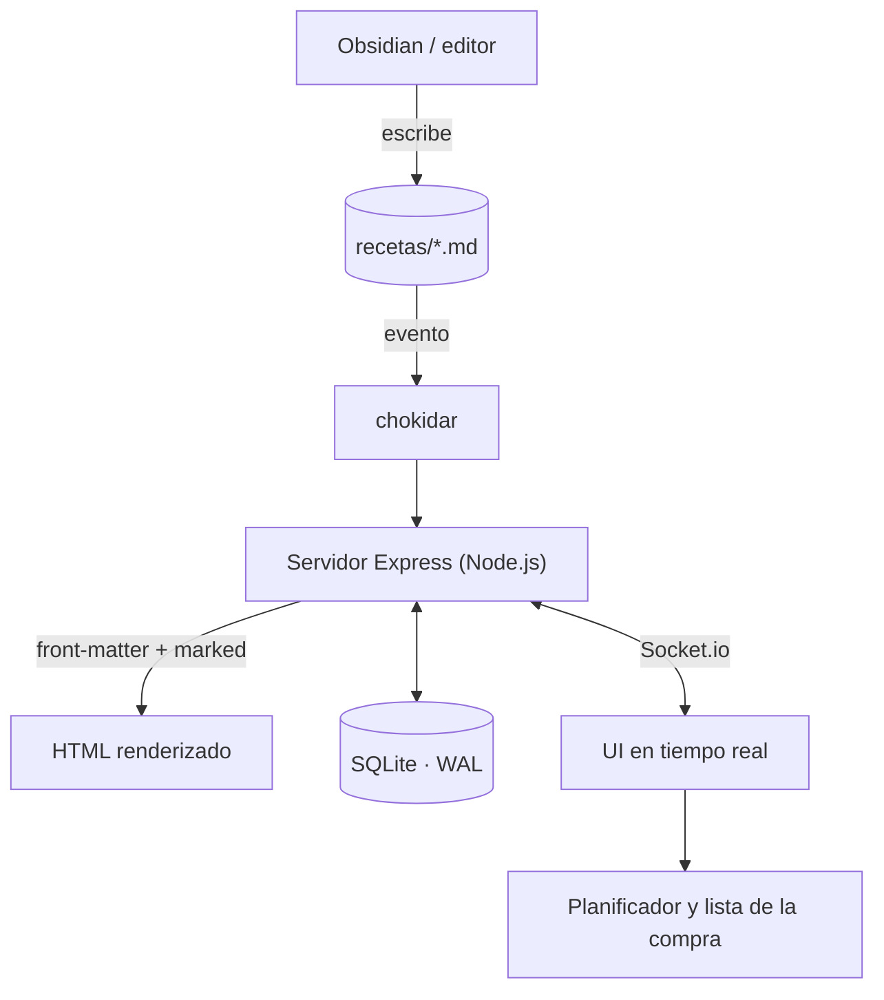

## El Desafío
La mayoría de gestores de recetas dependen de nubes propietarias o bases de datos opacas que dificultan la portabilidad. Quería una herramienta donde las recetas fueran simples archivos **Markdown** (usando el File System como base de datos principal), permitiendo que los datos fueran legibles, editables desde cualquier sitio (incluso desde Obsidian) y totalmente soberanos.

## Solución Técnica
El núcleo del proyecto es un servidor **Node.js** y **Express** optimizado para el manejo del sistema de archivos y sincronización en tiempo real.

### Arquitectura de datos
El recorrido de una receta, desde que se edita en cualquier archivo hasta que se refleja en todos los dispositivos conectados:

### Puntos Clave de la Implementación:
- **Markdown como Base de Datos:** Las recetas son archivos `.md`. Un sistema de vigilancia (`chokidar`) monitoriza la carpeta y actualiza la aplicación automáticamente al detectar cambios, renderizando con `front-matter` y `marked`.
- **Compatibilidad con Obsidian:** Soporte nativo para la sintaxis de imágenes `![[imagen.jpg]]` y enlaces `[[Receta]]`, integrándose perfectamente con flujos de trabajo de *Personal Knowledge Management* (PKM).
- **Caché y Metadatos en SQLite:** Para garantizar búsquedas instantáneas y filtrado avanzado (por etiquetas, ingredientes o dificultad), los metadatos y sesiones seguras se gestionan en **SQLite operando en modo WAL** (Write-Ahead Logging), lo que mejora drásticamente la concurrencia.
- **Sincronización en Tiempo Real:** Uso de **Socket.io** para actualizar instantáneamente la UI, la lista de la compra y el planificador semanal en todos los dispositivos conectados sin recargar la página.
- **Planificador y Lista Inteligente:** Módulos dedicados para organizar comidas en un calendario y extraer automáticamente los ingredientes necesarios para tu próxima visita al supermercado.

## Aprendizaje
Este proyecto reforzó mi comprensión sobre el manejo asíncrono de I/O en Node.js, WebSockets, y el diseño de arquitecturas híbridas (File System + SQLite) para crear plataformas donde el usuario retiene el control absoluto de su información.
